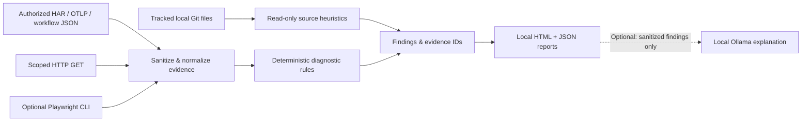

<div align="center">

# ⚡ BugCircuit

### Evidence-first diagnostics for web applications, APIs, authentication and workflows.

**Turn scattered failures into structured findings, traceable evidence and practical next checks.**

[](https://github.com/Seifalla2/BugCircuit/actions/workflows/test.yml)


[](LICENSE)


**[Get started](#quick-start) · [Showcase](#interactive-showcase) · [Features](#capabilities) · [Security](#privacy-and-security) · [Roadmap](docs/ROADMAP.md)**

</div>

---

## What is BugCircuit?

BugCircuit is a **local-first diagnostic workspace** built to make debugging more systematic. Import existing HAR, workflow or OpenTelemetry JSON evidence, inspect an authorized HTTP endpoint, or use optional Playwright capture from the command line. A deterministic analysis engine groups observations into findings with evidence IDs, severity, confidence labels and recommended verification steps.

**The key distinction:** a finding explains **what was observed**, not an invented root cause. For example, HTTP 403 confirms that access was refused to the inspected client; it does not prove a broken login, WAF configuration or missing scope.

No account or cloud model is needed for core diagnostics. **Optional Ollama** explanations run against sanitized summaries on the same laptop.

> [!IMPORTANT]
> **v0.5.2 alpha.** The dashboard and CLI are functional and the automated Python test/lint matrix runs on GitHub Actions. This is **not** a production-certified vulnerability scanner, automated fixer, crawler or multi-user hosted service. Real-world Windows browser QA, threat-model hardening and external validation are still open.

## Interactive showcase

Open a dedicated, screen-share-friendly presentation using **synthetic data only**:

```text
http://127.0.0.1:8765/showcase
```

The page presents three interactive cases, using the **real deterministic rules engine** on fictional inputs:

| Sample case | What the demo explains |
| --- | --- |
| OAuth callback | Observed failed callback and an explicitly reported state mismatch |
| API degradation | HTTP 503 and 429 evidence, prioritized diagnostic checks |
| Workflow interruption | Explicit failed and timed-out workflow executions |

The showcase does **not** load your stored reports, connected projects, local repository paths or AI configuration. It does not save demonstration reports. **It is a route on your own laptop, not a public website or a security boundary.** Never expose local port 8765 to the internet. For public screen sharing, stay on `/showcase` and do not reveal the owner workspace at `/`.

See the [demo walkthrough](docs/DEMO_GUIDE.md) for a safe, honest client/portfolio presentation.

## Capabilities

| Area | Supported today | Important limit |
| --- | --- | --- |
| HAR & HTTP evidence | Import HAR; flag 401, 403, 404, 429, 5xx, callback errors, observed redirect cycles | Imports are not browser automation |
| Live HTTP inspection | Authorized, bounded GET probes with redirect host scoping | Best-effort SSRF defense; no aggressive scanning |
| Browser diagnostics | Optional Playwright CLI capture of console/network errors and DOM overflow | Playwright capture is **not** yet in the dashboard |
| Workflow diagnostics | Offline workflow JSON failure, timeout and potential duplicate-trigger signals | Duplicate executions do not prove duplicate side effects |
| OpenTelemetry | Offline OTLP JSON error/span metadata import | Not full distributed tracing or graph reconstruction |
| Repository review | Read-only review of tracked files in local Git clones or explicitly cloned public GitHub repos | Python AST heuristics, not comprehensive multi-language SAST |
| Reporting | Local HTML/JSON reports with evidence timeline and suggested checks | Sanitization is best-effort: review before sharing |
| Local AI | Optional Ollama summary explanation; loopback port configurable | Suggestions are not verified causes; no cloud fallback |
| Windows workspace | Browser dashboard, saved reports and cautious fast-forward update check | Single-user local tool, **no remote access controls** |

### How it works



## Quick start

### Windows — recommended

1. Install [Python 3.10+](https://www.python.org/downloads/windows/) and [GitHub Desktop](https://desktop.github.com/) if needed.
2. Clone **[Seifalla2/BugCircuit](https://github.com/Seifalla2/BugCircuit)** with GitHub Desktop.
3. In the cloned folder, double-click **`Start BugCircuit.cmd`**. First startup creates an isolated Python environment and installs its dependencies.
4. Open **[127.0.0.1:8765](http://127.0.0.1:8765/)** for the owner dashboard or **[/showcase](http://127.0.0.1:8765/showcase)** for a synthetic demonstration. Keep the small server window running.

You can optionally start BugCircuit with Windows using `Enable Auto-start.cmd`; disable it with `Disable Auto-start.cmd`. The updater checks for clean fast-forward changes only, and **does not overwrite local edits**. Manual updates remain available through GitHub Desktop.

**Full guide:** [Windows setup, project connections and optional local AI](README-WINDOWS.md).

### Python CLI / macOS / Linux

```bash
git clone https://github.com/Seifalla2/BugCircuit.git
cd BugCircuit
python -m venv .venv
source .venv/bin/activate
python -m pip install -e .

# Offline sample using synthetic OAuth evidence
bugcircuit analyze-har examples/oauth-state-mismatch.har --out ./report

# Open ./report/report.html locally
# Optional local browser dashboard
bugcircuit serve --open
```

Windows terminal equivalent: activate with `.venv\Scripts\activate` before installing. The `.cmd` launcher above avoids terminal use on Windows.

### Other example commands

```bash
# Offline workflow and OpenTelemetry examples
bugcircuit analyze-workflow examples/workflow-failures.json --out ./workflow-report
bugcircuit analyze-otel examples/otel-errors.json --out ./otel-report

# Inspect only a URL you own or are explicitly authorized to inspect
bugcircuit inspect https://example.com --out ./http-report

# Optional Playwright capture (CLI only)
python -m pip install -e '.[browser]'
python -m playwright install chromium
bugcircuit capture https://example.com --check-layout --out ./browser-report

bugcircuit --help
```

**Sample output** (synthetic fixture; wording depends on input):

```text
BugCircuit v0.5.2 • 2 events • 2 findings
[HIGH] AUTH_CALLBACK_FAILED: Authentication callback failed
[HIGH] OAUTH_STATE_MISMATCH: OAuth state mismatch observed
JSON: .../report/report.json
HTML: .../report/report.html
```

## Connected repositories & local AI

Use **Projects** to connect a public GitHub URL (explicitly cloned locally) or a **private GitHub Desktop clone** already authenticated on your device. Source inspection is **read-only**: it does not run project scripts, commit, push, or edit site data. Only selected tracked files are considered. Private clone paths stay in the local application registry; normal browser project API responses do not expose those paths.

In a saved report, use **Find models → Explain report** to get optional guidance from a locally running [Ollama](https://ollama.com/). Default port is `11434`; you can configure `11435` or another loopback port in the report panel. The LLM receives sanitized diagnostic summaries, **not entire source files or raw HAR data**. AI is optional, and available model downloads need explicit confirmation.

## Privacy and security

- **Authorization required.** Scan only assets you own or have express permission to test. GET requests can still have effects on badly designed servers.
- **Local processing.** Imported raw HAR/JSON evidence is processed in memory; local output includes sanitized report files. Error strings, URLs or filenames can still contain sensitive metadata. **Always review reports before sharing.**
- **Network isolation.** The HTTP validator blocks private/reserved targets by default and scopes redirects. DNS rebinding and browser subresource requests are **not fully contained** without external sandboxing.
- **Local-only service.** The dashboard binds to `127.0.0.1`. It is **not authenticated** and must not be made publicly reachable with direct port forwarding.
- **Code transparency.** This repository is **public and MIT-licensed**. Its committed engine source is visible. Hiding a tab, minifying JavaScript or deleting current files does not make previously published Git history private.

Read [SECURITY.md](SECURITY.md), the [threat model](docs/SECURITY_MODEL.md), and [release checks](PUBLISHING.md).

## Project status and roadmap

| Verified | Pending |
| --- | --- |
| Automated Python unit/integration-style tests and Ruff lint on 3.10, 3.12 and 3.13 | Independent Windows/Chromium/RTL manual QA |
| Offline synthetic demonstration and sanitized reporting tests | Sandbox validation for malicious websites / DNS rebinding |
| Read-only project audit and local AI integration tests | External beta testing, benchmark datasets and signed distributables |

See [Roadmap](docs/ROADMAP.md) and [Changelog](CHANGELOG.md). Report a bug with a **synthetic reproduction** using [GitHub Issues](https://github.com/Seifalla2/BugCircuit/issues).

## For contributors

```bash
python -m pip install -e '.[dev]'
pytest -q
ruff check .
```

Keep changes small, write evidence-based tests, and **never upload client HAR files, credentials or private repository code**. See [CONTRIBUTING.md](CONTRIBUTING.md).

## License

[MIT License](LICENSE). BugCircuit is an independent project; it is not affiliated with GitHub, Microsoft, Playwright or any authentication provider.
